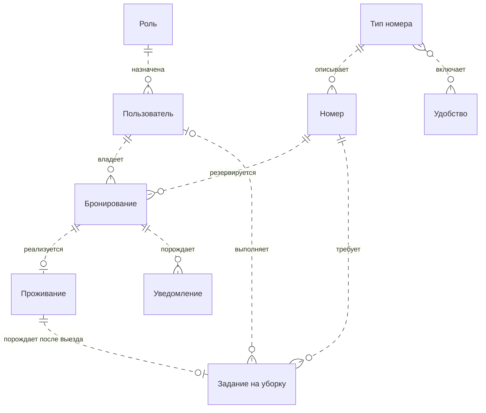
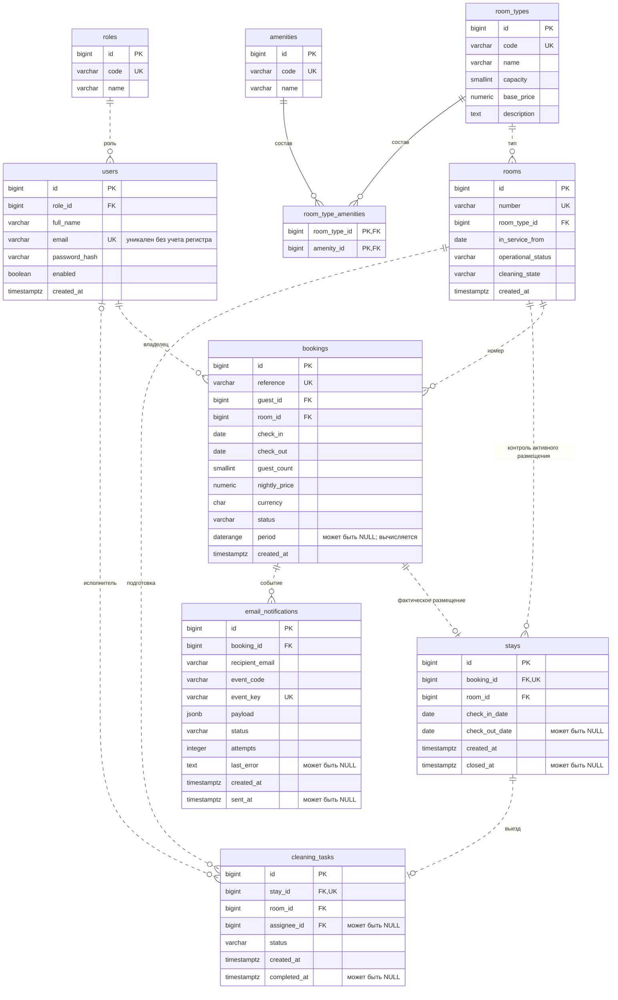

# 2. Разработка моделей данных

[Главная страница](../../README.md) · [Документация](../README.md) · [Предыдущий раздел](../01-analysis/README.md)

Раздел определяет структуру данных веб-приложения «Гостиница» по дисциплине «Разработка корпоративных приложений». В отличие от первого этапа, здесь представлены не только требования: схема реализована в PostgreSQL и проверена SQL-тестами. Одна гостиница, пять ролей, один конкретный номер на бронь и сохраненный тариф соответствуют принятому анализу.

## Содержание

- [2.1 Основания и границы модели](#21-основания-и-границы-модели)
- [2.2 Логическая модель](#22-логическая-модель)
- [2.3 Нормализация и физическая модель](#23-нормализация-и-физическая-модель)
- [2.4 Словарь данных](#24-словарь-данных)
- [2.5 Состояния и правила целостности](#25-состояния-и-правила-целостности)
- [2.6 Расчеты и интерфейсы чтения](#26-расчеты-и-интерфейсы-чтения)
- [2.7 Установка и примеры операций](#27-установка-и-примеры-операций)
- [2.8 Проверка и результат](#28-проверка-и-результат)

## 2.1 Основания и границы модели

Схема состоит из десяти таблиц. Роли приложения хранятся как данные и не создают пять отдельных пользователей сервера PostgreSQL. В текущей локальной установке владелец базы — пользователь, выполняющий установку. Серверная авторизация, работа веб-сеансов и фильтрация данных по текущему гостю будут реализованы в Spring Security; таблицы сами по себе не являются готовым пользовательским интерфейсом.

| Требования первого раздела | Объекты модели |
|---|---|
| FR-01, FR-02, FR-16: учетные записи и права | `roles`, `users`; дальнейшая авторизация в приложении |
| FR-03, FR-04: справочники и номерной фонд | `room_types`, `amenities`, `room_type_amenities`, `rooms` |
| FR-05—FR-08: поиск, бронь и история | `bookings`, поиск доступности, FK на владельца |
| FR-09—FR-11: заселение, продление и выезд | `stays`, согласование состояния с `bookings` |
| FR-12: подготовка номера | `cleaning_tasks`, чистота и эксплуатационное состояние `rooms` |
| FR-13, FR-14: статистика и отчет | Данные брони и проживания, функция отчета; файл XLSX относится к реализации приложения |
| FR-15: почтовые уведомления | `email_notifications`; фактическая SMTP-отправка относится к реализации приложения |

Паспортные данные, банковские операции, несколько гостиниц, групповые заказы, дополнительные услуги и фискальный учет не моделируются в этой версии. Демонстрационные данные вымышлены. День гостиницы определяется в часовом поясе `Europe/Moscow`; даты проживания хранятся без времени, технические события — с часовым поясом.

## 2.2 Логическая модель

На рисунке 2.1 показаны основные сущности и мощности связей. Обозначение «один — ноль или много» допускает отсутствие дочерних записей. Бронь может не перейти в проживание; задание появляется только после выезда; исполнитель уборки до назначения может отсутствовать.

**Рисунок 2.1 — Логическая модель предметной области**



Многие типы могут иметь одно и то же удобство. Эта связь «многие ко многим» в физической модели разрешается таблицей `room_type_amenities`. Фактическое проживание не заменяет бронь: у них разные даты и назначение. Отчет является результатом запроса и отдельной таблицы не требует.

## 2.3 Нормализация и физическая модель

Атрибуты атомарны, списки удобств вынесены в связующую таблицу. Описания ролей и типов не повторяются в каждом пользователе или заказе. Неключевые характеристики справочника зависят от его ключа; сочетание двух FK однозначно определяет запись связующей таблицы. Это устраняет основные аномалии изменения и соответствует нормализации до третьей нормальной формы для основной части модели.

В физической схеме осознанно повторяется `room_id` в проживании и задании на уборку. В `stays` составной FK `(booking_id, room_id)` гарантирует совпадение с бронью, а частичный уникальный индекс запрещает два активных проживания в помещении. В уборке соответствие проверяет триггер, а частичный индекс ограничивает число незавершенных заданий. Это контролируемая денормализация ради ограничений целостности; она не объявляется строгой третьей нормальной формой для этих атрибутов.

Цена в брони — самостоятельный снимок согласованных условий, а не постоянно обновляемая копия справочника. Итоговые суммы и доступность вычисляются; дублирующее поле «занят/свободен» в номере не хранится.

Рисунок 2.2 соответствует установленной физической схеме. `PK`, `FK`, `UK` означают первичный, внешний и уникальный ключ. Полные размеры типов и составные ограничения раскрыты в словаре и SQL.

**Рисунок 2.2 — Физическая модель PostgreSQL**



## 2.4 Словарь данных

Все `id` создаются как `bigint GENERATED ALWAYS AS IDENTITY`. Значения идентификаторов могут иметь пропуски после отката транзакции; непрерывная нумерация не является требованием. «Да» в колонке обязательности означает `NOT NULL`.

### 2.4.1 Роли — `roles`

| Поле | Тип PostgreSQL | Обязательно | Назначение |
|---|---|---|---|
| `id` | `bigint` | Да | Первичный ключ, автоматически создаваемый IDENTITY. |
| `code` | `varchar(30)` | Да | Один из пяти кодов ролей приложения; UNIQUE и CHECK. |
| `name` | `varchar(120)` | Да | Наименование для интерфейса. |

### 2.4.2 Пользователи — `users`

| Поле | Тип PostgreSQL | Обязательно | Назначение |
|---|---|---|---|
| `id` | `bigint` | Да | Первичный ключ, автоматически создаваемый IDENTITY. |
| `role_id` | `bigint` | Да | Внешний ключ roles; у учетной записи одна роль. |
| `full_name` | `varchar(160)` | Да | Отображаемое имя; не пустое. |
| `email` | `varchar(254)` | Да | Адрес с проверкой формата; UNIQUE по lower(email). |
| `password_hash` | `varchar(60)` | Да | Только BCrypt-хеш; исходный пароль не хранится. |
| `enabled` | `boolean` | Да | Признак действующей учетной записи. |
| `created_at` | `timestamptz` | Да | Момент создания записи. |

### 2.4.3 Типы номеров — `room_types`

| Поле | Тип PostgreSQL | Обязательно | Назначение |
|---|---|---|---|
| `id` | `bigint` | Да | Первичный ключ, автоматически создаваемый IDENTITY. |
| `code` | `varchar(30)` | Да | Уникальный технический код. |
| `name` | `varchar(120)` | Да | Наименование для интерфейса. |
| `capacity` | `smallint` | Да | Максимальное число гостей, строго больше нуля. |
| `base_price` | `numeric(12,2)` | Да | Текущий базовый тариф в рублях, строго больше нуля. |
| `description` | `text` | Да | Описание условий размещения. |

### 2.4.4 Удобства — `amenities`

| Поле | Тип PostgreSQL | Обязательно | Назначение |
|---|---|---|---|
| `id` | `bigint` | Да | Первичный ключ, автоматически создаваемый IDENTITY. |
| `code` | `varchar(40)` | Да | Уникальный технический код. |
| `name` | `varchar(120)` | Да | Наименование для интерфейса. |

### 2.4.5 Удобства типов номеров — `room_type_amenities`

| Поле | Тип PostgreSQL | Обязательно | Назначение |
|---|---|---|---|
| `room_type_id` | `bigint` | Да | FK на room_types; часть составного PK. |
| `amenity_id` | `bigint` | Да | FK на amenities; часть составного PK. |

### 2.4.6 Номерной фонд — `rooms`

| Поле | Тип PostgreSQL | Обязательно | Назначение |
|---|---|---|---|
| `id` | `bigint` | Да | Первичный ключ, автоматически создаваемый IDENTITY. |
| `number` | `varchar(12)` | Да | Уникальное обозначение номера; не пустое. |
| `room_type_id` | `bigint` | Да | FK на тип; изменение не нарушает активные брони. |
| `in_service_from` | `date` | Да | Начало учета помещения для исторической емкости фонда. |
| `operational_status` | `varchar(20)` | Да | AVAILABLE или MAINTENANCE. |
| `cleaning_state` | `varchar(10)` | Да | CLEAN или DIRTY; отдельно от занятости. |
| `created_at` | `timestamptz` | Да | Момент создания записи. |

### 2.4.7 Бронирования — `bookings`

| Поле | Тип PostgreSQL | Обязательно | Назначение |
|---|---|---|---|
| `id` | `bigint` | Да | Первичный ключ, автоматически создаваемый IDENTITY. |
| `reference` | `varchar(40)` | Да | Уникальный номер заказа, по умолчанию B- и UUID. |
| `guest_id` | `bigint` | Да | FK на владельца из users; при создании требуется действующий GUEST. |
| `room_id` | `bigint` | Да | Ссылка на конкретный физический номер. |
| `check_in` | `date` | Да | Плановая дата заезда, включается в интервал. |
| `check_out` | `date` | Да | Плановая дата выезда, не включается в интервал. |
| `guest_count` | `smallint` | Да | Положительное число, не больше вместимости. |
| `nightly_price` | `numeric(12,2)` | Да | Снимок тарифа; назначается триггером и не изменяется. |
| `currency` | `char(3)` | Да | Фиксированное значение RUB. |
| `status` | `varchar(15)` | Да | Состояние записи; допустимые значения описаны ниже. |
| `period` | `daterange` | Нет | Вычисляемый daterange; приложение его не записывает. |
| `created_at` | `timestamptz` | Да | Момент создания записи. |

### 2.4.8 Фактическое проживание — `stays`

| Поле | Тип PostgreSQL | Обязательно | Назначение |
|---|---|---|---|
| `id` | `bigint` | Да | Первичный ключ, автоматически создаваемый IDENTITY. |
| `booking_id` | `bigint` | Да | FK на бронь; UNIQUE, одно проживание на заказ. |
| `room_id` | `bigint` | Да | Контролируемое дублирование: составной FK сверяет номер с бронью. |
| `check_in_date` | `date` | Да | Фактический заезд; при заселении совпадает с текущей датой брони. |
| `check_out_date` | `date` | Нет | NULL для активного проживания; фактический выезд после завершения. |
| `created_at` | `timestamptz` | Да | Момент создания записи. |
| `closed_at` | `timestamptz` | Нет | Момент регистрации выезда; NULL до завершения. |

### 2.4.9 Задания на уборку — `cleaning_tasks`

| Поле | Тип PostgreSQL | Обязательно | Назначение |
|---|---|---|---|
| `id` | `bigint` | Да | Первичный ключ, автоматически создаваемый IDENTITY. |
| `stay_id` | `bigint` | Да | FK на завершенное проживание; UNIQUE, одно задание на выезд. |
| `room_id` | `bigint` | Да | Совпадение с номером проживания проверяется триггером. |
| `assignee_id` | `bigint` | Нет | Необязательный FK на users; исполнитель должен иметь роль CLEANER. |
| `status` | `varchar(10)` | Да | Состояние записи; допустимые значения описаны ниже. |
| `created_at` | `timestamptz` | Да | Момент создания записи. |
| `completed_at` | `timestamptz` | Нет | Заполняется при DONE; до выполнения NULL. |

### 2.4.10 Очередь уведомлений — `email_notifications`

| Поле | Тип PostgreSQL | Обязательно | Назначение |
|---|---|---|---|
| `id` | `bigint` | Да | Первичный ключ, автоматически создаваемый IDENTITY. |
| `booking_id` | `bigint` | Да | Ссылка на бронирование. |
| `recipient_email` | `varchar(254)` | Да | Снимок адреса получателя на момент события. |
| `event_code` | `varchar(30)` | Да | Тип события: подтверждение, отмена или изменение брони. |
| `event_key` | `varchar(160)` | Да | Уникальный ключ события; предотвращает дублирование. |
| `payload` | `jsonb` | Да | Объект JSON: номер заказа, даты, сохраненный тариф и валюта. |
| `status` | `varchar(10)` | Да | Состояние записи; допустимые значения описаны ниже. |
| `attempts` | `integer` | Да | Неотрицательное число попыток отправки. |
| `last_error` | `text` | Нет | Причина неудачной отправки; может отсутствовать. |
| `created_at` | `timestamptz` | Да | Момент создания записи. |
| `sent_at` | `timestamptz` | Нет | Момент отправки, обязателен только при SENT. |

## 2.5 Состояния и правила целостности

### Состояния

| Объект | Значения и переходы |
|---|---|
| Бронь | `CONFIRMED → CHECKED_IN → COMPLETED`; до заселения разрешено `CONFIRMED → CANCELLED`. После отмены или завершения запись неизменяема. |
| Проживание | Активно, пока `check_out_date IS NULL`; завершено после фиксации выезда. В представлении состояния называются `ACTIVE` и `COMPLETED`. |
| Чистота номера | `CLEAN` или `DIRTY`; выезд делает номер грязным, выполнение задания — чистым. |
| Эксплуатация | `AVAILABLE` или `MAINTENANCE`; завершение уборки ремонт не снимает. |
| Задание | Создается `PENDING`; действующий сотрудник `CLEANER` завершает его в `DONE`. |
| Уведомление | `PENDING`, `FAILED`, `SENT`; для `SENT` обязательна отметка времени. Исполнитель отправки появится вместе с приложением. |

### Ссылки, уникальность и история

Внешние ключи используют `ON DELETE RESTRICT`: удаление родительской записи не уничтожает историю каскадом. Триггеры дополнительно запрещают удаление броней, проживаний и заданий. Пользователь отключается флагом, номер временно блокируется; завершенные операции сохраняются.

Уникальны коды справочников, номер комнаты, внешний номер брони и email без учета регистра. Одна бронь связана не более чем с одним проживанием, один выезд — с одним заданием. В одном номере не бывает двух активных проживаний или двух ожидающих заданий на уборку.

### Интервалы и конкуренция

Интервал брони — `[check_in, check_out)`. Поэтому выезд 13 ноября и следующий заезд 13 ноября не пересекаются. Exclusion-ограничение `bookings_no_overlap` сопоставляет `room_id` и вычисляемый `daterange` для состояний `CONFIRMED` и `CHECKED_IN`. Отмененные и завершенные брони не блокируют будущий поиск.

Создание и изменения брони блокируют строку физического номера. Проверяется вместимость; при создании нужен действующий гость. Начальная дата не может быть в прошлом или раньше ввода помещения. Продление не меняет сохраненный тариф. Уменьшение вместимости типа и смена типа комнаты не могут сделать активный заказ недопустимым.

Просроченный незавершенный выезд удерживает физический номер даже после конца планового интервала. Это учитывается и поиском, и повторной проверкой перед сохранением. Результат поиска предварителен: только успешная запись в транзакции подтверждает бронь.

### Согласование операций

Проживание создается по подтвержденной брони в текущую дату заезда, только в чистый, свободный и не заблокированный номер. Триггер согласованно меняет состояние брони. При выезде в одной транзакции фиксируются завершение, грязное состояние и задание на уборку. Повтор той же отметки выезда не создает второй результат.

Уборку завершает действующий сотрудник нужной роли; заполнение `completed_at` выполняется автоматически. Прямая установка `CLEAN` при незавершенном задании запрещена. Для смены физического номера заказ отменяется и создается новый; перенос дат до заселения допускается после повторной проверки.

Почтовое событие записывается в той же транзакции, что и изменение брони. Откат не оставляет ложного подтверждения в очереди. Подтверждение и отмена имеют уникальные ключи; реальное изменение дат создает отдельное событие. SMTP сейчас не подключен, письма никому не отправляются.

## 2.6 Расчеты и интерфейсы чтения

| Представление или функция | Результат |
|---|---|
| `v_booking_details` | Бронь, владелец, номер и плановая сумма по сохраненному тарифу |
| `v_stay_history` | Фактические даты, вычисленное состояние, окончательная и предварительная суммы раздельно |
| `v_cleaning_queue` | Только незавершенные задания |
| `find_available_rooms(date, date, integer)` | Подходящие номера на интервал и число гостей; неверные параметры отклоняются |
| `hotel_report(date, date)` | Суточная емкость, занятые номеро-ночи, загрузка, окончательная выручка и предварительные начисления |

Плановая стоимость равна числу согласованных ночей, умноженному на `nightly_price`. При фактическом выезде окончательная сумма определяется длительностью проживания, минимум — одна ночь. Для активного проживания сумма предварительная и включает только уже наступившие ночи. Денежные вычисления используют `numeric`, без двоичной арифметики с плавающей точкой.

В отчете выручка означает начисления завершенных проживаний, распределенные по ночам периода. Это не учет банковских платежей. Для выезда в день заезда минимальное начисление относится к дате заезда, но фактических ночей такое проживание дает ноль. Предварительные суммы активных проживаний отображаются отдельно.

Загрузка равна занятым номеро-ночам, деленным на емкость периода и умноженным на 100%. В емкость входят помещения с даты ввода; временный ремонт ее не уменьшает. Текущая незавершенная ночь активного проживания еще не считается отработанной. При нулевой емкости возвращается `NULL`, а не ошибка деления. Даты после текущего дня не включаются в фактический отчет; конец периода исключается, поэтому максимальная дата конца — завтрашняя.

Интерфейсы чтения возвращают все разрешенные владельцу SQL-сеанса строки. В будущей программе слой сервисов обязан ограничивать гостя его собственными данными; наличие `guest_id` в представлении не является автоматической авторизацией.

## 2.7 Установка и примеры операций

Исходные SQL-файлы и команды находятся в [каталоге базы данных](../../database/README.md). Основной запуск из корня репозитория:

```sh
export PATH="/Applications/Postgres.app/Contents/Versions/latest/bin:$PATH"
psql -X -d postgres -v ON_ERROR_STOP=1 -f database/00_create_database.sql
```

Создается только `hotel_booking_web`; существующие базы других работ не меняются. Повторная установка сохраняет строки и не сбрасывает демонстрационные хеши. Миграция v1 помечается комментарием схемы; следующие изменения должны оформляться отдельными миграциями, а не незаметным переписыванием установленной версии.

В Postgres.app новая база появится в списке после обновления окна или повторного выбора сервера. Для просмотра можно выбрать `hotel_booking_web` и нажать `Connect…`.

```sql
-- Поиск на три ночи, для двух гостей.
SELECT * FROM find_available_rooms(hotel_today()+30, hotel_today()+33, 2);

-- Проверка истории и очереди уборок.
SELECT * FROM v_stay_history;
SELECT * FROM v_cleaning_queue;

-- Отчет за текущую календарную дату.
SELECT * FROM hotel_report(hotel_today(), hotel_today()+1);
```

Для операций заселения, выезда и уборки с откатом доступен [пошаговый пример](../../database/05_workflow_example.sql). В нем подбирается свободный чистый номер, создается новый заказ и выполняется полный цикл без изменения исходных демонстрационных записей.

Установлено пять вымышленных пользователей, три типа, четыре удобства и шесть комнат. Начальные сценарии: завершенный выезд с уборкой, действующее проживание и будущая бронь. Исходные случайные пароли не сохраняются; эти записи не предоставляют готового входа в веб-приложение. Все почтовые адреса относятся к `example.invalid`.

## 2.8 Проверка и результат

Проверка выполнена на PostgreSQL 18.4. Пройдена 51 регрессионная проверка, повторная установка с точным сравнением исходных строк и независимый тест двух конкурирующих транзакций. Подробности и команды воспроизведения находятся в [протоколе](verification.md).

Проверочная программа создает отдельную базу со случайным суффиксом, устанавливает туда схему и образцы и удаляет только созданную ею базу. Регрессионные изменения и моделирование календаря обернуты в транзакцию с `ROLLBACK`; точное сохранение исходных строк проверяется автоматически. Конкурентный тест подтверждает одну запись и SQLSTATE `23P01` у второго запроса.

Рабочая база содержит только исходные демонстрационные записи. На этом этапе готовы данные и SQL-интерфейсы; браузерные экраны, пользовательские сеансы, XLSX и фактическая отправка писем относятся к реализации приложения.

## Вывод по разделу

Логическая модель преобразована в физическую схему из десяти таблиц. Определены ключи, типы, состояния, правила сохранения истории и контролируемое дублирование номера в операционных таблицах. Ограничения и триггеры согласуют бронь, проживание и подготовку помещения; конкурентное пересечение отклоняется самой базой.

Создана отдельная PostgreSQL-база с воспроизводимой установкой, демонстрационным набором, запросами и проверками. Модель служит основой следующего этапа — проектирования архитектуры Spring-приложения.

[Главная страница](../../README.md) · [Документация](../README.md)
